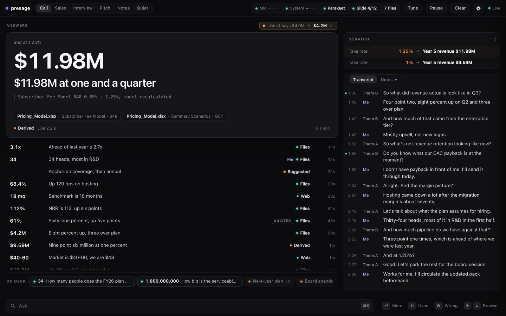

# presage

A call copilot for macOS that listens to your Zoom or Teams call and answers questions from a folder of your files, usually before the question is finished.



I built this while working at a strategy firm. On client calls someone would ask for a number that was sitting in a workbook I had open, and I'd lose ten seconds finding the right tab. presage keeps that number ready on a second screen while they're still asking.

## What it does

It hears both sides of the call (your mic as **Me**, the system audio as **Them**), transcribes locally, and watches the transcript for anything your files know about. When "Q3 revenue" or "headcount" comes up it drafts the likely answer and keeps it warm. When the question lands, the warm draft shows at once and a live answer confirms it a couple of seconds later.

Every answer is short: a figure, a 4 to 8 word line you can say out loud, and chips for the file and cell, page or slide it came from. If the files don't hold it, the card says "Not in files" instead of guessing. The page lives at `http://localhost:8766`, so you can open it on a second monitor or your phone.

The part I like most is scratch paper. When someone asks "what if we charged 1% instead of 0.85?", no cell holds that answer, and I didn't want the model doing arithmetic in its head. So presage compiles the workbook with pycel at index time, writes the new value into the input cell, recalculates everything downstream and reads the outputs back. On a 22-sheet model with 3,468 formulas the recalculation takes 57 ms. The card shows its working (`Subscriber Fee Model B48 0.85% → 1%, model recalculated`).

## How it works

```
bin/audiotap (Swift)     Core Audio process tap + mic, 16 kHz PCM, no virtual audio driver
        │
presage/stt/local.py     Silero VAD, Parakeet TDT 0.6B v3 on MLX, LiveKit turn detector
        │                re-decodes the open sentence every 0.7 s so words show up early
        │
presage/brain.py         topic match on every partial (<0.1 ms), speculative drafts,
        │                question gate, live answer with tools, what-if engine
        │
presage/llm/             Claude Code (Agent SDK, bills your plan), Anthropic API, or Gemini
        │
presage/server.py        FastAPI + WebSocket  ->  ui/index.html
```

- **Files.** Spreadsheets go into SQLite (one table per detected block plus a `cells` table with row labels, headers and refs) and are never chunked. PDFs, decks, docs and notes are chunked and searched with BM25. A background "deep index" pass then writes per-file summaries, pulls every number out of the prose with its sentence, and precomputes the questions someone is likely to ask per slide and table. It's cached by content hash; the sample folder costs about $0.15 and 47 s the first time.
- **Answers.** `claude-sonnet-5` writes the answer and `claude-haiku-4-5` runs alongside as a hedge. Whichever lands first renders, and Sonnet's replaces it. The model gets `find_cells`, `find_numbers`, `read`, `sql`, `search`, `whatif` and `calc`, and web search only when the files miss.
- **The gate.** Something has to decide whether a line is a question for me at all. That runs on Haiku by default, on TypeSafe's Jev API (about 180 ms) if you add a key, or locally on a fine-tuned Laya checkpoint. The training set for the local gate came from my own calls, so it isn't in this repo; without those weights presage uses Haiku or Jev.
- **End of turn.** A sentence that reads complete ends after 220 ms of silence; an unfinished one waits up to 900 ms. Clean questions finalize about 309 ms after the last word.

Modes change what it listens for:

| Mode | What shows up |
|---|---|
| Call | facts from your files, prefetched as topics come up, web on a miss |
| Sales | a one-line talk track for objections and pricing questions, plus the best supporting fact |
| Interview | a suggested first-person answer to each question, anchored on your CV in `context/` |
| Pitch | Call, plus short responses to pushback |
| Notes | no answers, just a running summary with actions and open questions |
| Quiet | nothing until you type |

## Running it

You need macOS 14.2 or newer on Apple Silicon, [uv](https://docs.astral.sh/uv/) and the Xcode Command Line Tools (`xcode-select --install`). No BlackHole and no change to your output device.

```bash
git clone https://github.com/Joconnell04/presage && cd presage
cp .env.example .env    # optional: keys can also be pasted into Settings
./run.sh                # installs deps, builds the audio helper, downloads Parakeet (~2.4 GB once)
./make_app.sh           # optional: ~/Applications/Presage.app, a double-clickable launcher
```

The page opens at http://localhost:8766. On first launch allow the microphone, then add Presage (or Terminal) under System Settings > Privacy & Security > Screen & System Audio Recording. macOS never prompts for that second one, and a missing grant just delivers silence, so watch the Mic and System dots in the top bar.

Drop your files into `context/` or point Settings > Files at any folder. It reads xlsx, xlsm, csv, pdf, pptx, docx, txt and md, and re-indexes when the folder changes.

The default provider is Claude Code: answers go through the Claude Agent SDK and draw from your Claude Pro or Max usage instead of an API key. Log in once with `claude` in Terminal. presage starts the harness with `strict_mcp_config` so your global MCP servers aren't injected (that alone was 127k to 267k tokens a request). If you also set an Anthropic key, the one latency-critical live answer per question goes to the API, which was about twice as fast under load.

To try it without a call, replay a synthesized client asking three questions about the sample folder:

```bash
PRESAGE_CONTEXT=sample_context PRESAGE_REPLAY=docs/replay/call.wav ./run.sh
```

You should get Q3 revenue of $14,020k citing `Acme_Financials.xlsx › P&L › D6`, 152 FTE, and 13.6% enterprise churn from the board memo. `sample_context/ANSWER_KEY.md` has the ground truth. To look at the page with no server at all, open `ui/index.html?mock=1` in a browser.

| Variable | What it does |
|---|---|
| `PRESAGE_LLM_PROVIDER` | `claude_code` (default), `anthropic` or `gemini` |
| `ANTHROPIC_API_KEY` | Anthropic API provider, and faster live answers |
| `GEMINI_API_KEY` | Gemini provider |
| `JEV_API_KEY` | hosted question gate from typesafe.ai |
| `PRESAGE_ANSWER_MODEL`, `PRESAGE_HEDGE_MODEL` | override the two answer models (an empty hedge turns it off) |
| `STT_PROVIDER` | `local` (default) or `deepgram` with `DEEPGRAM_API_KEY` |
| `PRESAGE_CONTEXT`, `PRESAGE_REPLAY` | folder to index, wav to feed in as the far side |

There's also a Raycast extension in `raycast-ext/` (Toggle, Pause and Listen; install with `npx ray develop`) and plain script commands in `raycast/` that do the same thing.

Offline checks: `uv run python -m presage.prerun_smoke`, `presage.ingest.link_smoke`, `presage.drift`.

## What's rough

- Use headphones. With speakers the mic hears the far side and the same words land in both streams.
- AirPods report a healthy mic and send digital silence when in-ear detection kicks in. The helper reopens the mic after 3 s and falls back to the built-in one, but pick the MacBook mic if you want your own voice reliably.
- Gemini and Deepgram are written against their docs and haven't run against a real key.
- Scratch paper only moves numeric input cells. A scenario chosen by a text switch, or a structural change like adding a row, is out of reach. If pycel can't evaluate a function, the card says "partial recalc" rather than quietly using the stale cached value.
- Every local speech engine I tried hears "ARR" as "air". There's a glossary in `presage/brain.py` for spoken forms; extend it for your own jargon.
- Lots of comments point at `docs/experiments/`, `docs/research-*.md` and `data/gate/`. Those were my experiment logs and the gate training set, built partly from real calls, and they stay private. The code that used them is still here.
- `presage/sim/` writes and replays synthetic calls against `sample_context`. The larger test folder I used alongside it isn't included.

The wire protocol between the server and the page is in `docs/ui-protocol.md`, and the design tokens are in `docs/design/`.
